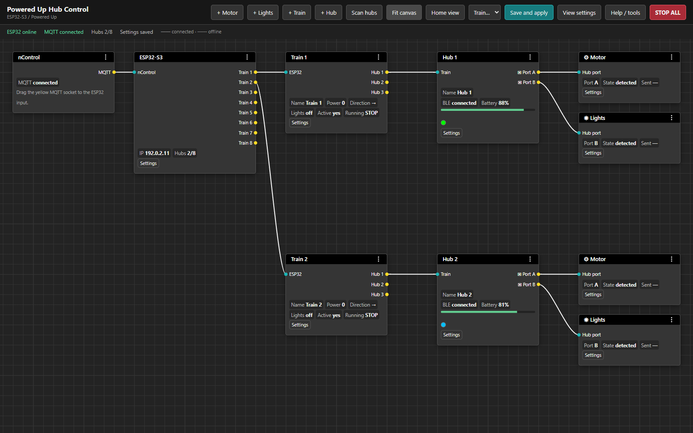

# Powered Up Hub Control

ESP32 firmware for **nControl model railway control through MQTT**. Configure
trains, LEGO hub ports, motors and lights using an offline node editor served by
the ESP32.

**This edition:** ESP32-S3, up to eight LEGO Powered Up hubs over Bluetooth LE.

## Features

- Eight train slots and eight BLE hub slots; several hubs can belong to one train.
- Per-train power limit, ramp, light brightness and braking configuration.
- Two configured motor outputs and one light output per hub, with exclusive port ownership.
- Individual motor polarity, brief motor tests and per-train or global STOP.
- Battery readings, BLE state, firmware information and hub LED color control.
- Local BaklavaJS node editor: drag connections, snap to a 24 px grid, and choose
  curved, straight or orthogonal wires. Mouse-wheel zoom is disabled.
- Status-only nodes; editing and actions live in the sidebar. Renaming a train
  node does not change its MQTT label. nControl and ESP32 nodes cannot be deleted.
- Explicit **Save and apply** for configuration and output assignment changes.
  LED color and STOP actions take effect immediately.
- JSON import/export, OTA upload and diagnostics in the same interface.
- Wi-Fi setup access point, DHCP hostname, mDNS and MQTT availability metadata.
- No CDN or internet connection is needed to use the web panel.

## Web interface

An offline node editor with a dark canvas, a 24 px grid, compact controls,
sidebar settings and explicit **Save and apply** for configuration changes.

The interface, help and diagnostics are in English. Everything is served locally
by the ESP32; no CDN or internet connection is needed at runtime. Renaming a node
does not change its MQTT label. The nControl and ESP32 root nodes are protected
against deletion.



*Documentation preview with sample values; no physical outputs are operated.*

## Hardware

The tested board is an **ESP32-S3 UNO with 16 MB flash**, using PlatformIO's
`esp32-s3-devkitc-1` profile with a 16 MB flash override. PSRAM is not required.
Check your board's actual flash capacity before using this partition table.

Motors and lights connect to the LEGO hubs, **not directly to ESP32 GPIO**.
This firmware is a BLE bridge, not a replacement motor driver.
BLE host capacity is eight connections; the controller is configured for ten
BLE activities to allow scanning alongside connections.

## First use

1. Flash the firmware and open the panel URL reported by the serial monitor.
2. If the configured Wi-Fi is unavailable, connect to the setup AP named
   `PU-Hub-<device-suffix>-setup`, password **12345678**, and open
   `http://192.168.4.1`.
3. Open **Settings** on the ESP32 node. Enter the Wi-Fi SSID and nControl MQTT
   broker address, then **Save and apply**. Blank password fields keep saved passwords.
4. Select **Scan hubs**, switch on your hubs and assign each discovered device
   to a hub slot. Address type is filled automatically from the scan.
5. Connect a Train output to a hub input. Connect hub ports A/B to motor or light
   nodes. Set each Train's **Label in nControl** to exactly match the nControl label.
6. Set motor direction, train power limits and light brightness, then save.
7. Send a new power command from nControl to start movement.

Switch each hub on once, in any order; no fixed delay is required. The ESP32
connects one hub at a time. Wait for the connection before pressing its button
again. After restarting or flashing the ESP32, check that the hubs remain on.

Solid wires indicate an online connection; dashed wires indicate an assignment
whose connection is offline. No wire means no assignment. Disconnect an input
using the corresponding sidebar action, then save.

Move nodes by their headers and pan with the middle mouse button. **Fit canvas**
shows all nodes; **Go to train** centers a train. Layout and view preferences are
stored in that browser, while hardware configuration is stored in ESP32 NVS.
Deleting a Train or hub hides its slot; **+ Train** and **+ Hub** restore slots.

## MQTT compatibility

The ESP32 is an MQTT client. Enter the nControl computer's broker address in
**ESP32 Settings**; the default TCP port is **1883**. The bridge subscribes to
**`nControl/websocket/rx`**, where nControl publishes train commands. The `rx`
suffix is part of nControl's protocol naming.

Set each Train's **Label in nControl** to the exact tile label, including spaces
and letter case. For a tile named `Train 1`, the supported commands are:

| Example payload | Action |
| --- | --- |
| `T\|Train 1\|p,40` | Set power to 40%; valid range is 0–100. Zero stops the train's outputs. |
| `T\|Train 1\|f` | Select forward direction. |
| `T\|Train 1\|r` | Select reverse direction. |
| `T\|Train 1\|l,1` | Switch lights on; `l,0` switches them off. |
| `T\|Train 1\|b,3` | Update the train's nControl battery indicator, range 0–5. |
| `T\|Train 1\|a,1` | Update the train's nControl active indicator, 0 or 1. |

The battery and active indicators do not start or enable motor movement. Actual
hub battery percentages are read over BLE. Unknown labels, unsupported commands
and malformed payloads are ignored. Retained messages do not operate outputs.

After MQTT reconnect the bridge subscribes again and keeps outputs stopped.
It does not send `W|ST` or replay cached power commands. Motor movement requires
a new non-retained power command; a direction command alone does not restart it.
The T protocol carries no reliable Simulation/Operational mode indication.

After each MQTT connection the ESP32 publishes retained QoS 1 node metadata to
`nControl/nodes/<node_id>/info` and `{"online":true}` to
`nControl/nodes/<node_id>/status`. Its Last Will publishes `{"online":false}`.
The stable node ID derives from the MAC address. Metadata includes the device
name, client ID, model, firmware, IP and web URL.

Diagnostic hub telemetry is published under the configured prefix, for example
`nControl/bridge/esp32s3/status` and `nControl/bridge/esp32s3/hubs/1/state`.
This prefix is separate from the incoming train-command topic.

## Output behavior

STOP ALL, loss of Wi-Fi/MQTT/BLE, configuration changes, restart and OTA stop
the outputs. After STOP or reconnection, movement requires a **new power command**.
A direction command alone does not restore previous power. There is no separate
ARM or synchronization confirmation in the current interface.

Motor direction changes use a stop phase and a 150 ms pause. Configured port
numbers determine the outputs; device detection is diagnostic and does not gate
commands. Select the physical port containing the intended compatible device.
Motor tests are explicitly triggered, run at ±10%, and last at most 0.6 s.

Hub LED color uses the discovered internal RGB LED port, independently of the
external light ports. The panel offers 24 presets and displays a color dot on
the node. Color is saved immediately and reapplied after reconnection. Black
turns the LED off. `led_rgb: -1` means no color override.

Hub property reads are serialized; missing properties are retried and established
readings are refreshed periodically. STOP and output commands take priority.
Only recently advertised configured BLE addresses are attempted; failed attempts
time out and retry with backoff, without blocking other enabled hub slots.

## Build and upload

Requirements: Python 3, PlatformIO Core and Node.js 18+ for rebuilding the editor.
Pinned firmware dependencies: Espressif platform **6.11.0**, ESP-IDF **5.4.1**
(`framework-espidf` **3.50401.0**) and `espressif/mdns` **1.8.2**.

The generated offline HTML is included, so building the firmware does not require npm.

```sh
pio run -e esp32s3 -j 2
python tools/audit_build.py
pio run -e esp32s3 -t upload --upload-port YOUR_PORT -j 2
pio device monitor --port YOUR_PORT --baud 115200
```

Use the actual serial port, such as `COM5` or `/dev/ttyUSB0`. Build and flash boards
one at a time. PlatformIO generates the web asset before dependency scanning so
incremental builds include the current panel.

To rebuild the editor:

```sh
cd web-editor
npm ci
npm run build
cd ..
node web-editor/test.cjs
```

The editor uses BaklavaJS **2.8.1** and Vue **3.5.22**. The pinned renderer patches
are checked during bundling; review them before upgrading. Third-party notices
are in `web-editor/THIRD-PARTY-NOTICES.txt` and the generated HTML.

## Configuration and testing

### Local configuration

`tools/provision.py` creates local `provisioning.json` and generated headers.
These are excluded from Git. The default fallback AP password is `12345678`;
change it in device settings for your deployment. The legacy `panel_password`
field remains for NVS compatibility but the web server does not use it.

The panel and API have **no login** and are accessible to devices that can reach
the ESP32. POST requests require `X-Bridge: 1`; CORS is not enabled. Use a trusted
local network. The AP password is separate from the router Wi-Fi password.

### OTA

The partition table contains two 3 MB app slots. Upload the project's
`.pio/build/esp32s3/firmware.bin` through **Help / tools → Import, export, OTA and
diagnostics → OTA update**. The panel requests STOP, waits for delivery and
shows upload progress. A successful upload restarts the ESP32. A failed OTA
attempt may leave the maintenance lock active until restart.

### Verification

```sh
node web-editor/test.cjs
python tools/test_host.py
python tools/audit_build.py
```

The native core test needs a C compiler (`CC`, or `cc` on PATH). Windows development
can also use Zig at `.pio/host-tools/ziglang/zig.exe`.
`python tools/web_preview.py` serves a loopback-only sample UI at
`http://127.0.0.1:8765`; it does not operate hardware.

See [test results](TEST-RESULTS.md) and the [eight-hub hardware test](docs/HARDWARE-TEST.md).
A successful build is not a sustained eight-hub reliability result.

## Source layout

| Path | Responsibility |
| --- | --- |
| `main/core.c` | Command parsing, routing, ramps, STOP and LEGO protocol |
| `main/ble.c` | Scanning, GATT, connection scheduling and BLE output queue |
| `main/network.c` | Wi-Fi, MQTT, availability metadata and mDNS |
| `main/config.c` | Configuration, validation and NVS migration |
| `main/web.c` | HTTP API and OTA |
| `web-editor/src/` | English node editor source |
| `main/web/index.html` | Generated offline panel |
| `examples/config.json` | Credential-free example configuration |
| `tests/` | Native core tests |

Protocol reference: [LEGO Wireless Protocol](https://lego.github.io/lego-ble-wireless-protocol-docs/).
